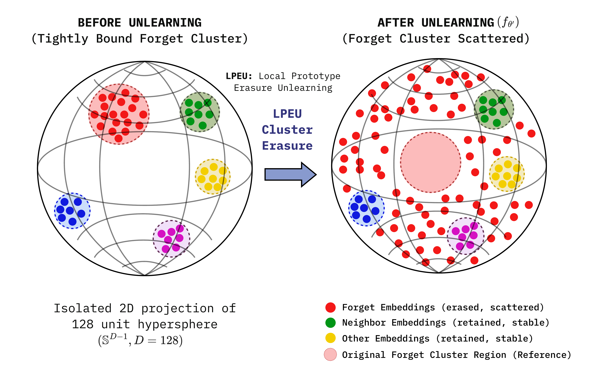
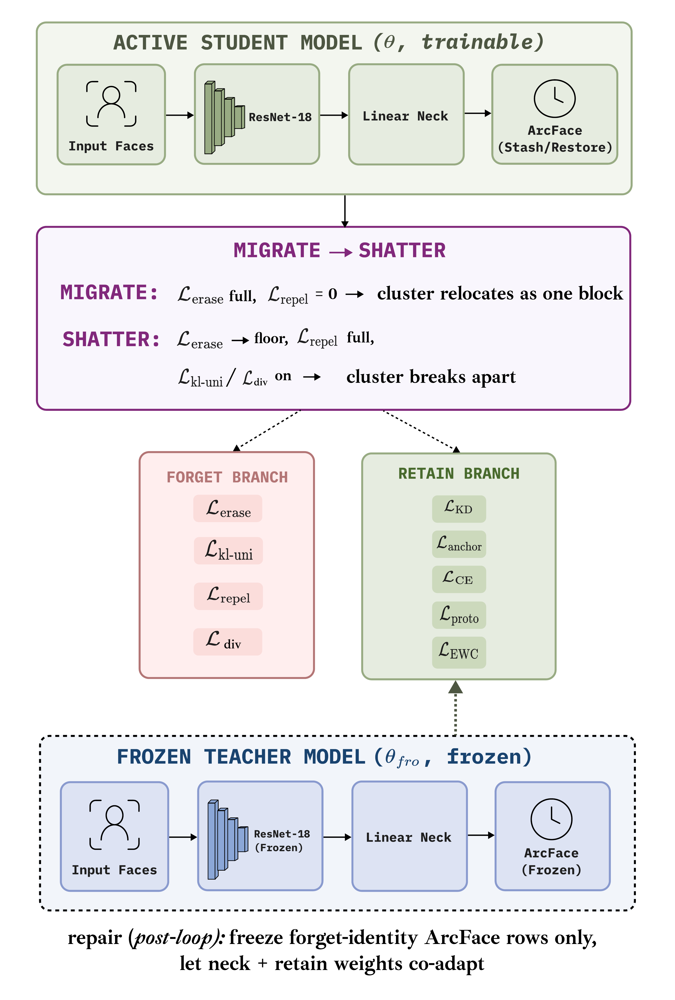
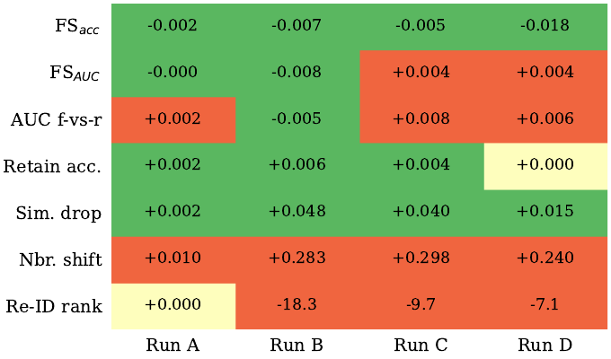
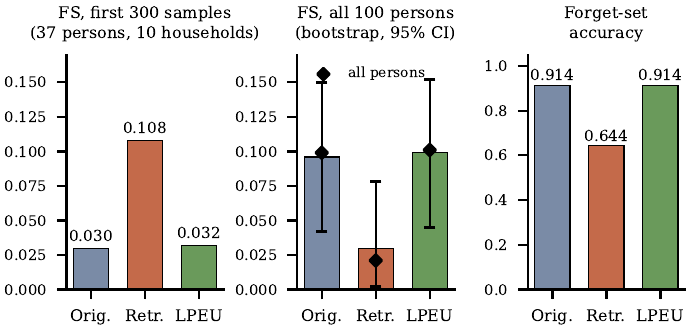

# Local Prototype Erasure Unlearning: Representation-Level Forgetting for Deep Face Recognition

Code and results for the paper *Local Prototype Erasure Unlearning: Representation-Level Forgetting for Deep Face Recognition* (Le Thanh Tam, Le Hoang Thai — Faculty of Information Technology, University of Science, VNU-HCM). Submitted to FJCAI 2027.



## Idea

Most unlearning methods for face models act on the **output**: the model is made to mispredict the forgotten data, while its embedding may still hold a tight cluster for each forgotten person. **LPEU** works on the **representation**: it breaks the embedding cluster of a forgotten identity while protecting neighbouring identities.

- **Forget branch** — moves the forgotten cluster away from its prototype (*migrate*), then scatters it (*shatter*): `L_erase`, `L_repel`, `L_ent`, and the new matched-unseen divergence `L_div`, which pulls the outputs on forgotten images toward the original model's outputs on unseen people.
- **Retain branch** — distillation, cross-entropy, neighbour anchors, class-prototype pull and EWC.
- **Conflict handling** — PCGrad between the two branches and projection of the forget update away from the protected neighbour prototypes.
- **New in this paper** — person-level forgetting with per-person prototypes and per-person protected neighbours, and `L_div`.



## Evaluation protocol

| | MUFAC Exp. 1 | MUFAC Exp. 2 (controlled) | VGGFace2 |
|---|---|---|---|
| Forget unit | 100 persons | 100 persons | 100 of 1,217 identities |
| Runs | 4 | 1 (+ seed 7 for Original/Retrain) | 1 |
| Retrained-from-scratch reference | – | yes | yes |
| `L_div` data vs. attacker data | shared pool | disjoint pools | disjoint persons |
| Checkpoint selection | retain test | retain validation | retain validation |
| Forgetting score | first 300 samples | all forgotten persons + identity-level bootstrap | all forgotten persons + identity-level bootstrap |
| `L_div` ablation | – | yes | yes |

Forgetting score `FS = |0.5 − M|`, with `M` the accuracy of a threshold membership-inference attacker (loss on MUFAC, max-softmax confidence on VGGFace2) separating forgotten images from images of people never used in training.

## Results

**MUFAC, Experiment 1 (mean ± s.d. over 4 runs)**

| Method | Retain acc. | FS_acc (first 300) | Sim. drop | Nbr. shift | Re-ID rank |
|---|---|---|---|---|---|
| Original | 0.726 ± 0.007 | 0.092 ± 0.041 | 0.000 | 0.000 | 304.3 |
| Fine-tune | 0.725 ± 0.007 | 0.094 ± 0.040 | 0.000 | 0.003 | 304.5 |
| NegGrad | 0.724 ± 0.009 | 0.092 ± 0.043 | 0.000 | 0.003 | 304.5 |
| **LPEU** | **0.729 ± 0.006** | 0.085 ± 0.048 | **0.026 ± 0.022** | 0.208 ± 0.134 | 295.5 |

**MUFAC, Experiment 2 (controlled, seed 42)**

| Method | Retain acc. | Forget acc. | FS_acc (all persons) | Bootstrap mean [95% CI] | Nbr. shift |
|---|---|---|---|---|---|
| Original | 0.698 | 0.914 | 0.099 | 0.096 [0.042, 0.150] | – |
| Retrain | 0.693 | 0.644 | 0.021 | 0.030 [0.002, 0.078] | n/a |
| Fine-tune | 0.699 | 0.914 | 0.101 | 0.098 [0.043, 0.153] | 0.008 |
| NegGrad | 0.698 | 0.914 | 0.099 | 0.097 [0.042, 0.150] | 0.007 |
| **LPEU** | **0.701** | 0.914 | 0.101 | 0.099 [0.045, 0.152] | 0.010 |
| LPEU w/o L_div | 0.701 | 0.914 | 0.102 | 0.100 [0.045, 0.153] | 0.010 |

**VGGFace2 (identity = class, seed 42)**

| Method | Retain acc. | Forget acc. | FS_acc | Re-ID top-1 | Cos. to own prototype | Nbr. shift |
|---|---|---|---|---|---|---|
| Original | 0.483 | 1.000 | 0.412 | 1.000 | 1.000 | – |
| Retrain | 0.465 | 0.000 | 0.022 | 0.292 | – | – |
| Fine-tune | 0.484 | 1.000 | 0.411 | 1.000 | 0.999 | 0.043 |
| NegGrad | 0.481 | 1.000 | 0.412 | 1.000 | 0.998 | 0.077 |
| **LPEU** | **0.487** | 1.000 | 0.417 | 1.000 | **0.949** | 0.258 |
| LPEU w/o L_div | 0.486 | 1.000 | 0.437 | 1.000 | 0.842 | 0.531 |

**Summary**

- LPEU is the only method that changes the representation of the forgotten persons, on both datasets.
- It keeps retain accuracy at or above the original model's on both datasets.
- On VGGFace2, `L_div` halves the displacement of neighbouring identities.
- Under the controlled protocol, the membership signal of the forgotten persons stays at the original model's level, whereas retraining removes it.
- On VGGFace2, each forgotten person's cluster is displaced rather than dissolved: within-person cosine stays at 0.950, while the cosine between different forgotten persons rises from 0.003 to 0.070.

The paper analyses why this happens and what a representation-level objective must achieve to close the gap. It also shows that a forgetting score computed on a small fixed subset (the first 300 samples) can reverse the ranking of the original and retrained models.

<p align="center"> </p>

## Repository structure

```
figures/                         figures used in the paper
src/mufac/
  lpeu-v7-mufac.ipynb            MUFAC person-level LPEU (Experiment 1)
  lpeu-mufac-person-resubmit.ipynb
                                 MUFAC controlled run (Experiment 2): disjoint L_div/attacker pools,
                                 validation-based selection, Retrain reference, L_div ablation,
                                 per-sample losses saved for the bootstrap
src/vggface2/
  lpeu-v7-vggface2.ipynb         earlier preliminary VGGFace2 notebook (superseded by modal/)
  modal/                         VGGFace2 pipeline used for the paper, run on Modal (L40S GPU)
    step1_prepare_data.py        builds a uint8 image cache (1,352 identities x 40 images, 128x128)
    lpeu_core.py                 LPEU, baselines and metrics (shared notebook cells)
    vgg_pipeline.py              split, training, unlearning and evaluation
    step2_run_vgg.py             Modal entry point
analysis/
  vgg_identity_bootstrap.py      identity-level bootstrap of the forgetting score (VGGFace2)
results/                         result files for every table in the paper
```

## Running

**MUFAC.** Open the notebooks on Kaggle with the MUFAC data attached (`custom_train_dataset.csv`, `train_images/`) and run all cells. In `lpeu-mufac-person-resubmit.ipynb`, set `RUN_SEED` in cell B2.

**VGGFace2 on Modal.**

```bash
pip install modal && modal setup
modal run src/vggface2/modal/step1_prepare_data.py      # once: builds the image cache
modal run --detach src/vggface2/modal/step2_run_vgg.py --seed 42
modal volume get lpeu-vgg-cache runs/vgg_seed42 .
python analysis/vgg_identity_bootstrap.py               # run inside the downloaded folder
```

`step1_prepare_data.py` expects VGGFace2 training images in a Modal volume named `lpeu-vggface2`. Adjust the path for your own copy of the dataset.
